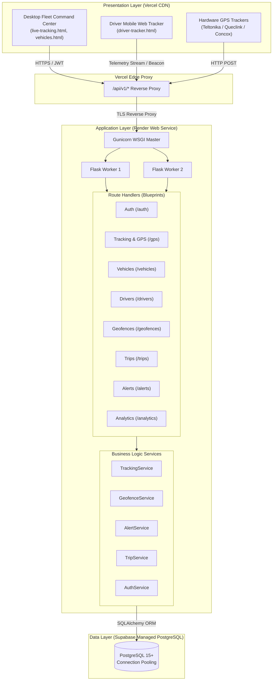
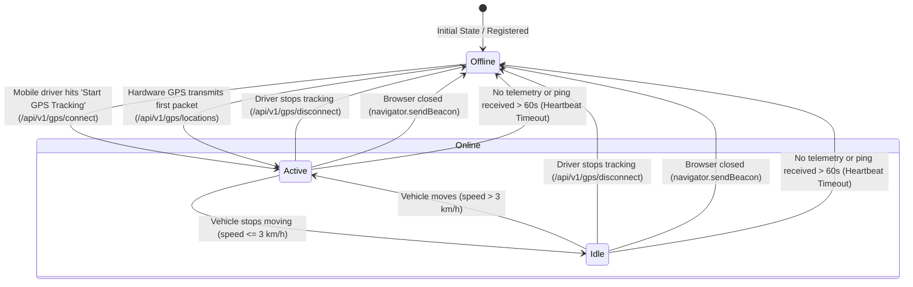

# 🏗️ System Architecture: Transport GPS Tracking System

## 1. High-Level Architecture Overview

The system follows a decoupled client-server architecture:
- **Presentation Tier**: Lightweight, responsive Single-Page Application (SPA) style interface delivered via Vercel Edge CDN.
- **Application Tier**: Modular Flask REST API on Render using service-layer abstraction and Gunicorn workers.
- **Data Tier**: Relational PostgreSQL database on Supabase supporting ACID transactions and high-frequency time-series GPS logging.



---

## 2. Real-Time GPS Telemetry Pipeline

When a telemetry packet arrives at `POST /api/v1/gps/locations`:

```mermaid
sequenceDiagram
    autonumber
    actor Tracker as Driver Mobile / GPS Kit
    participant Route as tracking_routes.py
    participant Svc as TrackingService
    participant Geo as GeofenceService
    participant Alert as AlertService
    participant DB as PostgreSQL Database
    actor Dispatch as Live Fleet Radar (Dispatcher)

    Tracker->>Route: POST /api/v1/gps/locations (lat, lng, speed, heading, battery)
    Route->>Svc: process_telemetry(data)
    
    rect rgb(20, 30, 45)
        Note over Svc: 1. Resolve vehicle (by ID, IMEI, or Reg #)
        Note over Svc: 2. Query previous coordinate point
        Note over Svc: 3. Compute Haversine distance increment
        Note over Svc: 4. Update vehicle odometer & status
    end

    Svc->>Alert: check_overspeed(vehicle, lat, lng, speed)
    alt Speed > Threshold
        Alert->>DB: Create Alert record (severity: warning/critical)
    end

    Svc->>Geo: check_vehicle_geofences(vehicle, lat, lng, last_point)
    alt Geofence Boundary Crossed (Entry / Exit)
        Geo->>DB: Create Geofence Event & Alert
    end

    Svc->>DB: Commit GPSTelemetry record & updated vehicle status
    Svc-->>Route: Return telemetry confirmation & alert count
    Route-->>Tracker: HTTP 201 Created

    loop Polling Every 4-5 Seconds
        Dispatch->>Route: GET /api/v1/gps/live
        Route->>Svc: get_live_fleet_positions()
        Svc->>DB: Fetch latest telemetry & connection recency
        Svc-->>Dispatch: Returns fleet array (lat, lng, is_online, speed, heading)
        Dispatch->>Dispatch: Update Leaflet markers & vehicle cards
    end
```



---

## 3. Device Online / Offline Lifecycle

The system features real-time connection state management to ensure dispatchers know precisely when a truck is actively connected, parked, or disconnected.



---

## 4. Backend Service Architecture

The backend isolates concerns into distinct architectural tiers:

```
backend/
├── app/
│   ├── models/            # SQLAlchemy Database Entities (ORM)
│   │   ├── user.py        # Authentication & RBAC accounts
│   │   ├── vehicle.py     # Commercial trucks & telemetry relations
│   │   ├── driver.py      # Operator roster & license compliance
│   │   ├── gps_device.py  # Hardware tracking units (IMEI)
│   │   ├── telemetry.py   # High-throughput time-series coordinates
│   │   ├── geofence.py    # Spatial boundaries (Polygon / Circle)
│   │   ├── trip.py        # Manifests, cargo loads & stops
│   │   ├── alert.py       # Incidents, speeding & geofence violations
│   │   └── organization.py# Tenant account & fleet config
│   │
│   ├── routes/            # REST API Blueprints & Request Validation
│   │   ├── auth_routes.py
│   │   ├── tracking_routes.py
│   │   ├── vehicle_routes.py
│   │   ├── driver_routes.py
│   │   ├── geofence_routes.py
│   │   ├── trip_routes.py
│   │   ├── alert_routes.py
│   │   └── analytics_routes.py
│   │
│   ├── services/          # Pure Business Logic Layer
│   │   ├── tracking_service.py # Telemetry, distance math, live fleet
│   │   ├── geofence_service.py # Ray-casting point-in-polygon math
│   │   ├── alert_service.py    # Safety violation rules
│   │   ├── trip_service.py     # Dispatch, cargo & stop detection
│   │   └── auth_service.py     # Password hashing & JWT generation
│   │
│   └── utils/             # Helper libraries & Decorators
│       ├── geo_utils.py        # Haversine distance & ray-casting
│       ├── response_utils.py   # Standard JSON response envelopes
│       └── decorators.py       # Role enforcement & error boundaries
```

---

## 5. Frontend Client Architecture

The frontend is built using standard, framework-free web technologies:

- **`ApiClient` (`api.js`)**: Centralized HTTP client managing JWT token injection, automated token refresh, and network failure toasts.
- **`FleetMap` (`map.js`)**: Leaflet map controller managing custom vehicle pin icons with rotation transforms (`heading`), marker clustering, polylines, and geofence SVG overlays.
- **`ThemeManager` (`theme.js`)**: Instant toggle between Dark and Light color palettes with persistence in `localStorage`.
- **`DriverTracker` (`driver-tracker.js`)**: Mobile web driver app utilizing HTML5 Geolocation, Screen WakeLock, and offline sync.
