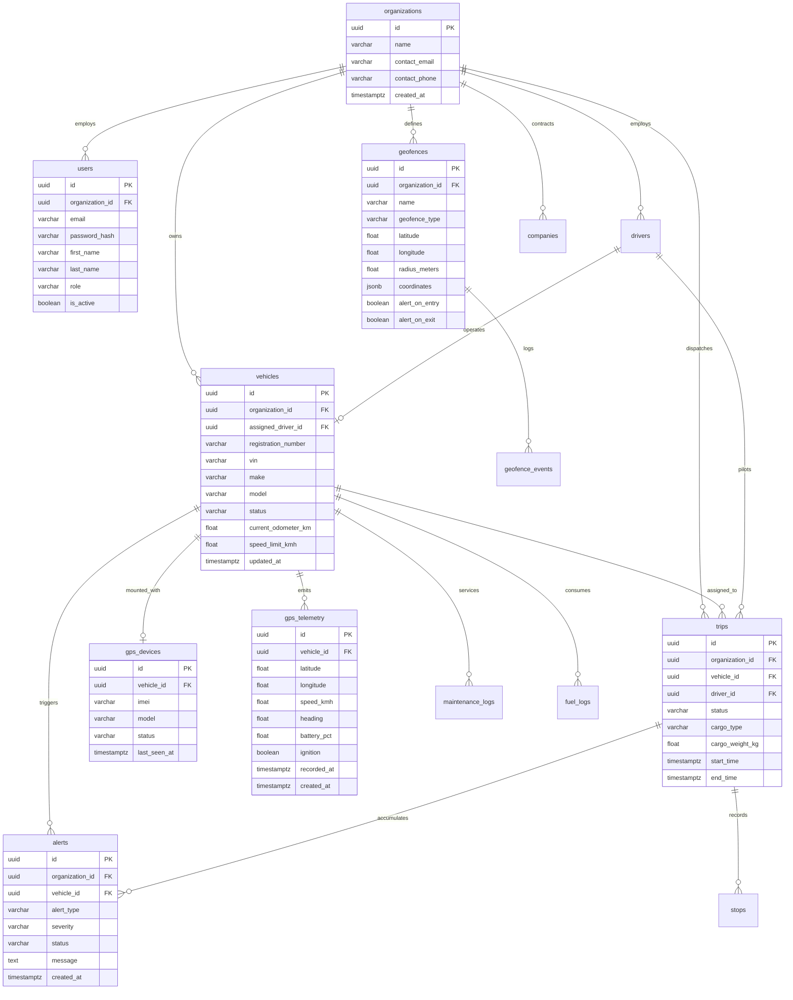

# 🗄️ Database Schema Specification: Transport GPS Tracking System

The system is designed for **PostgreSQL 15+** (hosted on **Supabase** in production) and supports **SQLite 3** for local development and lightning-fast automated pytest execution.

---

## 1. Entity-Relationship Diagram (ERD)



---

## 2. Table Specifications

### 2.1 `organizations`
Multi-tenant root container for fleet operators.
| Column | Type | Constraints | Description |
| :--- | :--- | :--- | :--- |
| `id` | VARCHAR(36) | PRIMARY KEY | UUID identifier |
| `name` | VARCHAR(120) | NOT NULL | Carrier / logistics company name |
| `contact_email` | VARCHAR(120) | NOT NULL, UNIQUE | Primary administrative email |
| `contact_phone` | VARCHAR(25) | NULL | Dispatch contact phone |
| `created_at` | TIMESTAMPTZ | NOT NULL, DEFAULT NOW() | Record creation timestamp |
| `updated_at` | TIMESTAMPTZ | NOT NULL, DEFAULT NOW() | Last update timestamp |

### 2.2 `users`
Authenticated operators, managers, dispatchers, and drivers.
| Column | Type | Constraints | Description |
| :--- | :--- | :--- | :--- |
| `id` | VARCHAR(36) | PRIMARY KEY | UUID identifier |
| `organization_id` | VARCHAR(36) | FK(organizations.id) | Tenant reference |
| `email` | VARCHAR(120) | NOT NULL, UNIQUE | Login email address |
| `password_hash` | VARCHAR(255) | NOT NULL | Scrypt / bcrypt password hash |
| `first_name` | VARCHAR(60) | NOT NULL | First name |
| `last_name` | VARCHAR(60) | NOT NULL | Last name |
| `role` | VARCHAR(20) | NOT NULL, DEFAULT 'viewer' | `admin`, `fleet_manager`, `dispatcher`, `driver`, `viewer` |
| `is_active` | BOOLEAN | NOT NULL, DEFAULT TRUE | Account lock flag |
| `created_at` | TIMESTAMPTZ | NOT NULL | Record creation timestamp |

### 2.3 `vehicles`
Commercial trucks and mobile fleet assets.
| Column | Type | Constraints | Description |
| :--- | :--- | :--- | :--- |
| `id` | VARCHAR(36) | PRIMARY KEY | UUID identifier |
| `organization_id` | VARCHAR(36) | FK(organizations.id) | Tenant reference |
| `assigned_driver_id`| VARCHAR(36) | FK(drivers.id, SET NULL)| Assigned operator |
| `registration_number`| VARCHAR(30) | NOT NULL, UNIQUE | License plate (e.g. `MH-04-AB-1234`) |
| `vin` | VARCHAR(50) | NULL, UNIQUE | Vehicle Identification Number |
| `make` | VARCHAR(60) | NOT NULL | Manufacturer (Tata, BharatBenz, Volvo) |
| `model` | VARCHAR(60) | NOT NULL | Model specification |
| `status` | VARCHAR(20) | NOT NULL, DEFAULT 'active' | `active`, `idle`, `maintenance`, `offline`, `decommissioned` |
| `current_odometer_km`| FLOAT | NOT NULL, DEFAULT 0.0 | Cumulative distance traveled |
| `speed_limit_kmh` | FLOAT | NULL | Vehicle safety limit override |
| `updated_at` | TIMESTAMPTZ | NOT NULL | Timestamp of last signal/modification |

### 2.4 `gps_telemetry`
High-frequency coordinate log and sensor readings.
| Column | Type | Constraints | Description |
| :--- | :--- | :--- | :--- |
| `id` | VARCHAR(36) | PRIMARY KEY | UUID identifier |
| `vehicle_id` | VARCHAR(36) | FK(vehicles.id), INDEX | Linked vehicle |
| `latitude` | FLOAT | NOT NULL | Latitude (WGS 84, -90 to 90) |
| `longitude` | FLOAT | NOT NULL | Longitude (WGS 84, -180 to 180) |
| `speed_kmh` | FLOAT | NOT NULL, DEFAULT 0.0 | Ground speed in km/h |
| `heading` | FLOAT | NOT NULL, DEFAULT 0.0 | Compass orientation (0 - 359.9°) |
| `battery_pct` | FLOAT | NULL | Driver phone or tracker battery % |
| `ignition` | BOOLEAN | NOT NULL, DEFAULT TRUE | Engine / Tracking running state |
| `recorded_at` | TIMESTAMPTZ | NOT NULL, INDEX | Sensor timestamp |
| `created_at` | TIMESTAMPTZ | NOT NULL, INDEX | Ingestion timestamp |

### 2.5 `geofences`
Virtual spatial perimeters (depots, customer yards, prohibited zones).
| Column | Type | Constraints | Description |
| :--- | :--- | :--- | :--- |
| `id` | VARCHAR(36) | PRIMARY KEY | UUID identifier |
| `organization_id` | VARCHAR(36) | FK(organizations.id) | Tenant reference |
| `name` | VARCHAR(100) | NOT NULL | Human-readable name |
| `geofence_type` | VARCHAR(20) | NOT NULL | `circle` or `polygon` |
| `latitude` | FLOAT | NULL | Center latitude (for circular) |
| `longitude` | FLOAT | NULL | Center longitude (for circular) |
| `radius_meters` | FLOAT | NULL | Radius in meters (for circular) |
| `coordinates` | JSON / JSONB | NULL | Array of `{lat, lng}` points (for polygon) |
| `alert_on_entry` | BOOLEAN | NOT NULL, DEFAULT TRUE | Trigger alert when truck enters |
| `alert_on_exit` | BOOLEAN | NOT NULL, DEFAULT TRUE | Trigger alert when truck departs |

---

## 3. High-Performance Indexing Strategy

To guarantee rapid queries under millions of telemetry coordinates, the following compound and specialized indexes are enforced:

```sql
-- Fast historical GPS breadcrumb playback
CREATE INDEX idx_telemetry_vehicle_time ON gps_telemetry (vehicle_id, recorded_at DESC);

-- Fast live fleet radar queries
CREATE INDEX idx_vehicles_org_status ON vehicles (organization_id, status);

-- Fast device lookup by hardware IMEI
CREATE UNIQUE INDEX idx_gps_devices_imei ON gps_devices (imei);

-- Fast plate search with case insensitivity
CREATE INDEX idx_vehicles_registration ON vehicles (LOWER(registration_number));
```
